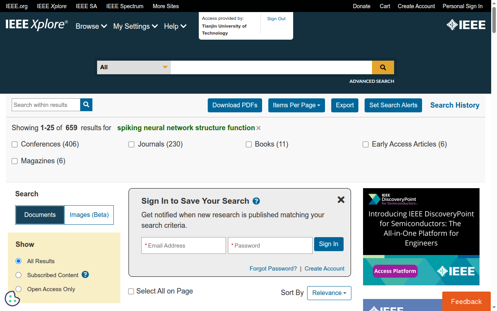

# dsh-carsi-papers


[](https://www.npmjs.com/package/dsh-carsi-papers)
[](LICENSE)
[](https://github.com/cannotgetaname/dsh-carsi-papers/actions/workflows/ci.yml)
[](package.json)

English | [中文](README.zh.md)


Campus-subscribed literature access for DeepSeek Harness, driven through a dedicated browser:
**CNKI (中国知网), Wanfang (万方), IEEE Xplore, ScienceDirect and Springer Nature Link**.

Open-access finders stop where the paywall starts. Campus subscriptions live behind an institutional
sign-in (CARSI / Shibboleth) or a campus IP, so this plugin keeps its own Chrome profile with a local
debugging port and lets the agent work inside that authenticated session: search the database, read
the record, download the subscribed PDF, verify what arrived, and save it with a usable name.

## Why this exists

Literature agents usually stop at open-access copies and preprints, because that is all the public
APIs return. The papers you actually need are behind a campus subscription, and that subscription is
tied to a browser session: a CARSI / Shibboleth sign-in, or a campus IP.

This plugin keeps its own Chrome profile with a local debugging port, so the agent works **inside that
authenticated session**: search the database with its own API, download the subscribed PDF, verify the
bytes, save it with a usable name, and export citations. Paywalls and robot checks are reported, never
bypassed.

## Demo



The header reads **Access provided by: Tianjin University of Technology** — that session is what the
agent searches and downloads through.

```
papers_search   query="structure-function relationship spiking neural network"
                publishers=["ieee", "springer"] rows=4
→ 8 merged hits, every record labelled by the databases that returned it

papers_fetch    publisher=springer url=https://link.springer.com/article/10.1038/s41467-025-62202-1
→ saved: refs/2025-Yang-Spiking dynamics of individual neurons ….pdf
  2.4 MB · 12 pages · verified PDF

papers_export   format=bibtex
→ refs/carsi-records.bib (downloaded records only)
```

## Tools

| Tool | Purpose |
|---|---|
| `papers_status` | Whether the research Chrome is running, its port, profile directory, and open tabs. |
| `papers_search` | Search a database; returns normalized records with each item's access state. |
| `papers_fetch` | Download one PDF, verify it, save it under `downloadDir`, and append an audit line. |
| `papers_access` | Open a publisher page and report institution, paywall, and robot-challenge state. |
| `papers_export` | Write the session's records as BibTeX, RIS, or GB/T 7714 for Zotero or a paper. |
| `papers_enrich` | Fill missing authors, venue, and year from Crossref by DOI. |
| `papers_zotero` | Write the session's records straight into the local Zotero library. |
| `papers_doctor` | Self-check: browser, profile, download directory, every database, Zotero. |
| `ref_audit` | Audit a reference list (.bib/.tex/numbered) against Crossref per entry. |
| `ref_format` | Emit GB/T 7714 entries, filling missing fields from Crossref. |
| `campus_status` / `campus_mark` | Judge whether the network is still the recorded campus one. |
| `papers_login` | Open the institutional sign-in entry and hand the window to the user. |
| `papers_open` | Open any URL in the research browser; reports title, final URL, and page flags. |
| `papers_eval` | Run JavaScript in the active page — the escape hatch for an unadapted database. |

## Searching several databases

`papers_search` takes either one `publisher` or a `publishers` list. With a list it queries each
database in turn and merges the results by DOI (falling back to a normalized title), so one call
answers "is this paper in anything we subscribe to?" and every record lists the databases that
returned it.

## Exporting records

`papers_export` turns the records seen in the session into `carsi-records.bib` or `.ris` inside the
downloads directory, ready to drag into Zotero.

## Supported databases

| Adapter | Search | PDF |
|---|---|---|
| `ieee` (IEEE Xplore) | site REST endpoint | stamped PDF endpoint |
| `springer` (Springer Nature Link) | result page DOM | article PDF link |
| `sd` (ScienceDirect) | result page DOM | signed asset URL, fetched in page |
| `cnki` (中国知网) | site grid endpoint (HTML fragment) | article page `#pdfDown` button |
| `wanfang` (万方) | result page DOM | detail page download link (needs an institutional balance) |

Adding a database means adding one object to `ADAPTERS` in `lib/papers.js`: `origin`, `match`,
`search(page, query, options)`, `pdf(page, record)`, and optionally `articleUrl(record)` and
`metadata(page)`.

## Debugging an adapter

```sh
npm run capture -- <url> [name] [--wait=6000]
```

Saves the rendered DOM, a screenshot, the page metadata, and every XHR/Fetch response (including
request bodies) under `debug/<name>/`, so a new database can be reverse-engineered offline and its
markup turned into a fixture for `npm test`.

## Behaviour worth knowing

- **Sign-in stays human.** The plugin never types, stores, or replays credentials. When a page needs a
  CARSI sign-in or a robot check, `papers_*` raises a desktop notification, brings the browser forward,
  and waits up to 90 seconds for the user to finish, then continues.
- **Access is reported, never bypassed.** Paywalls and challenges are surfaced as state. Only what the
  signed-in subscription already entitles is fetched.
- **Downloads are verified.** Bytes must start with `%PDF-`; the page count comes from `pdfinfo` when
  installed and from the page tree otherwise. A paywall page saved as `.pdf` is rejected.
- **Files are named `year-firstAuthor-title.pdf`** from the publisher record seen in the preceding
  search, falling back to the article page metadata.
- **Every search and download appends a line** to `carsi-audit.jsonl` in the downloads directory.
- **Pacing and a session cap:** requests are spaced (`requestGapMs`, default 1500) and at most
  `maxDownloads` (default 30) files are written per process.

## Configuration

The bundle row accepts these fields (defaults in parentheses):

| Field | Meaning |
|---|---|
| `port` (`9222`) | Chrome debugging port for the research browser. |
| `profileDir` (`$DSH_HOME/papers-browser`) | Chrome profile that keeps the institutional sessions. |
| `downloadDir` (`<cwd>/refs`) | Where PDFs and the audit log are written. |
| `maxDownloads` (`30`) | Downloads per process before the plugin refuses. |
| `requestGapMs` (`1500`) | Minimum spacing between publisher requests. |
| `executablePath` | Chrome/Chromium/Edge binary when discovery fails. |

## Local Zotero

`papers_zotero` talks to Zotero's local HTTP API (`127.0.0.1:23119`). Reads need nothing; the first
write needs an approval you give once in the Zotero window, and the resulting key is read from
`ZOTERO_API_KEY` or `$DSH_HOME/zotero-api-key` (mode 600). It is never written into the repository.

## Tests

```sh
npm test          # 123 offline checks: units, fixtures in headless Chrome, tool schemas
npm run test:unit # no browser needed
npm run test:live # opt-in, hits real publishers
```

## Install

```sh
dsh plugin --profile <profile> add /absolute/path/to/dsh-carsi-papers
```

or **Plugins → Add plugin** with this directory. The plugin starts Chrome itself; it needs no npm
dependencies and no build step.

## Limitations

- One dedicated profile means the first visit to each publisher may need one manual institutional
  sign-in; publisher sessions expire on their schedule and are renewed the same way.
- Cloudflare robot checks are personal: the user clears them, the plugin waits and then continues.
- IEEE publishes no Highwire citation tags, so its file names rely on the preceding search record.
- `papers_eval` can do anything the signed-in session can; it is a diagnostic tool, not a sandbox.
